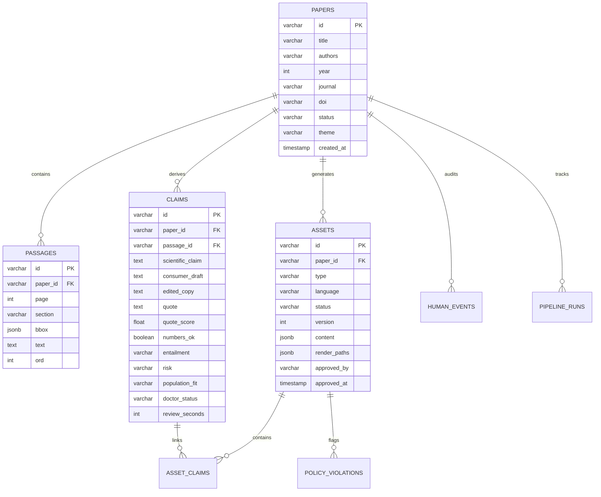

# SteerProof: Complete Technical Documentation & Engineering Manual

> **Document Version**: 2.0  
> **Target Audience**: Systems Engineers, Clinical Reviewers, ML Practitioners, Security Auditors, Frontend Engineers  
> **Last Updated**: October 2026  

---

## Table of Contents
1. [Executive Summary & Problem Statement](#1-executive-summary--problem-statement)
2. [High-Level Architecture & Deployment Topology](#2-high-level-architecture--deployment-topology)
3. [End-to-End Pipeline Detailed Specification](#3-end-to-end-pipeline-detailed-specification)
   - [Stage 1: Document Parsing & Layout Geometry (Docling)](#stage-1-document-parsing--layout-geometry-docling)
   - [Stage 2: Fact & Claim Extraction (Gemini Structured Generation)](#stage-2-fact--claim-extraction-gemini-structured-generation)
   - [Stage 3: Automated Tri-Layer Verification Engine](#stage-3-automated-tri-layer-verification-engine)
   - [Stage 4: Gate 1 Doctor Claim Verification Console](#stage-4-gate-1-doctor-claim-verification-console)
   - [Stage 5: Multi-Format Content Writing Engine](#stage-5-multi-format-content-writing-engine)
   - [Stage 6: Deterministic Policy Checker (14 Compliance Rules)](#stage-6-deterministic-policy-checker-14-compliance-rules)
   - [Stage 7: Multi-Format Asset Rendering Engine](#stage-7-multi-format-asset-rendering-engine)
   - [Stage 8: Gate 2 Human Compliance Sign-off & Watermark Invalidation](#stage-8-gate-2-human-compliance-sign-off--watermark-invalidation)
   - [Stage 9: Cryptographic Export Packaging](#stage-9-cryptographic-export-packaging)
4. [Complete REST API Reference Manual](#4-complete-rest-api-reference-manual)
5. [Database Schema & Data Model](#5-database-schema--data-model)
6. [Clinical Guardrails & Advertising Safety Matrix](#6-clinical-guardrails--advertising-safety-matrix)
7. [Environment Variables & Configuration Reference](#7-environment-variables--configuration-reference)
8. [Testing, Quality Assurance & Verification Results](#8-testing-quality-assurance--verification-results)
9. [Operational Guide & Troubleshooting](#9-operational-guide--troubleshooting)

---

## 1. Executive Summary & Problem Statement

### 1.1 The Challenge
Metabolic health content on modern social media platforms (Instagram, TikTok, YouTube Shorts) suffers from widespread misinformation, sensationalist overclaims, and lack of accountability:
- Medical research papers are dense, multi-column PDFs containing complex statistical analyses inaccessible to the lay consumer.
- Content creators extract extreme numbers out of context (e.g. converting exploratory secondary endpoints into absolute guarantees).
- Pharmaceutical brand names are routinely used without disclosure, violating health advertising regulations.
- Study findings conducted on Western cohorts are presented as universally applicable without acknowledging the unique pathophysiology of South Asian populations (e.g. higher visceral adiposity at lower BMIs, early beta-cell exhaustion).

### 1.2 The SteerProof Solution
SteerProof is a dual-gated clinical verification and multi-format content generation engine. It automates the ingestion of metabolic clinical trials and produces publication-ready Instagram assets with a mathematical guarantee of evidence traceability:
1. **Traceability Guarantee**: Every sentence, headline, or metric rendered in an asset maps to an extracted passage, which maps to a normalized bounding box on a specific PDF page.
2. **Dual-Gate Enforcement**: No content is generated without doctor sign-off on extracted claims (Gate 1), and no content can be exported without sign-off on the rendered visual assets (Gate 2).
3. **Deterministic Guardrails**: 14 hardcoded medical advertising rules reject unscientific copy, drug brand mentions, hype words, and absolute timeline promises.
4. **$0 Total Infrastructure Cost**: Built completely on open-source tools and free-tier APIs.

---

## 2. High-Level Architecture & Deployment Topology

SteerProof is organized as a distributed, polyglot microservice system operating across four application tiers backed by PostgreSQL:

```
┌─────────────────────────────────────────────────────────────────────────────┐
│                           Next.js 14 Web Frontend                           │
│                 Port 3000 · React 18 · Tailwind · Lucide                    │
│   - Papers List & Pipeline Monitor (/papers/[id])                           │
│   - Gate 1 Claims Console with PDF Canvas BBox Highlight (/claims)          │
│   - Gate 2 Multi-Format Asset Review Console (/assets)                      │
│   - Export Release Packager (/export)                                       │
└──────────────────────────────────────┬──────────────────────────────────────┘
                                       │ HTTP / REST
┌──────────────────────────────────────▼──────────────────────────────────────┐
│                       Core API Server (Spring Boot 3.3.4)                    │
│                 Port 8080 · Java 21 OpenJDK · JPA Hibernate                 │
│   - Paper, Claim, Passage & Asset Lifecycle State Machines                  │
│   - Deterministic 14-Rule Policy Checker Engine                             │
│   - Flyway Schema Migrations (V1, V2)                                       │
│   - Human Event Auditing & Release Packaging (ZIP)                          │
└───────────────────────┬───────────────────────────────┬─────────────────────┘
                        │                               │
        HTTP / JSON     │                               │ HTTP / JSON
┌───────────────────────▼─────────────┐   ┌─────────────▼─────────────────────┐
│       Python ML Service (FastAPI)   │   │     Render Service (Node.js)      │
│     Port 8001 · Python 3.12         │   │   Port 8002 · Express · TypeScript│
│ - Docling 2.x Multi-Column Parser   │   │ - Playwright Headless Chromium    │
│ - PyMuPDF Coordinate Mapping        │   │   (HTML/CSS -> 1080x1350 PNG)     │
│ - Rapidfuzz Fuzzy Levenshtein Check │   │ - Remotion 4.0 React Engine       │
│ - Number Normalisation Engine       │   │   (1080x1920 MP4 Video Reels)     │
│ - Gemini 3.7 Flash Extraction/NLI   │   │ - Safe-zone Subtitle Alignment    │
│ - Microsoft Edge-TTS Audio Engine   │   └───────────────────────────────────┘
│ - Pixabay B-Roll Video Search & Cdn │
└───────────────────────┬─────────────┘
                        │
                        ▼
┌─────────────────────────────────────────────────────────────────────────────┐
│                          PostgreSQL 16 Database                             │
│                     Port 5432 · Docker Container                            │
│   - Relational Tables: papers, passages, claims, assets, violations         │
│   - Immutable Audit Records: audit_log, human_events, pipeline_runs         │
└─────────────────────────────────────────────────────────────────────────────┘
```

---

## 3. End-to-End Pipeline Detailed Specification

### Stage 1: Document Parsing & Layout Geometry (Docling)
- **Engine**: IBM Docling 2.x layout model running locally in `ml-service/app/parse/`.
- **Coordinate System**: PyMuPDF maps PDF points to normalized coordinate space `[l, t, r, b]` where $l, r \in [0, \text{width}]$ and $t, b \in [0, \text{height}]$.
- **Granularity Constraints**:
  - Consecutive narrative paragraphs on the same page and section are merged only if each paragraph is under 200 characters.
  - Paragraphs are **never merged across page boundaries**.
  - Bounding box height ceiling: No passage bounding box can exceed $45\%$ of page height. Any passage exceeding $45\%$ is split into its constituent semantic blocks.
- **Deduplication**: SHA-256 fingerprinting on passage text eliminates duplicate headers and footers.

### Stage 2: Fact & Claim Extraction (Gemini Structured Generation)
- **Model**: Google Gemini 3.7 Flash (`gemini-3.7-flash`), configured with strict JSON schemas via `google-genai`.
- **Outputs**:
  - `scientificClaim`: Objective, publication-grade factual summary of the finding.
  - `consumerDraft`: Clear, empathetic lay translation written strictly in third-person past tense describing trial participants (e.g. *"People in this study lost..."*, never *"You will lose..."*).
  - `quote`: Verbatim substring extracted from the source passage.
  - `findingClass`: Core clinical category (`PRIMARY_ENDPOINT`, `SECONDARY_ENDPOINT`, `EXPLORATORY`, `SAFETY`, `MECHANISM`).
- **Pharma Brand Abstraction**: Drug brand names (e.g. Ozempic, Wegovy, Mounjaro) are automatically abstracted to generic terms (*"the medicine"*, *"the GLP-1 receptor agonist"*).

### Stage 3: Automated Tri-Layer Verification Engine
Every candidate claim passes through three independent algorithmic checks in `ml-service/app/verify/`:

1. **Quote Fuzzy Verification (`rapidfuzz`)**:
   $$\text{score} = \text{LevenshteinNormalized}(\text{quote}, \text{passageText}) \times 100$$
   - Score $\ge 85\%$: Accepted as authentic quote.
   - Score $< 85\%$: Automatic neighbor passage inspection ($\pm 2$ passages). If unmatchable, claim is flagged `NEEDS_EVIDENCE`.

2. **Strict Numeric Normalisation Engine**:
   Extracts all numeric tokens, units, and ranges from both `scientificClaim` and `consumerDraft` and cross-references them against `quote`.
   - Normalises en-dashes (`–`), em-dashes (`—`), hyphens, `"to"`, and whitespace in ranges (e.g. `"15–20%"` $\equiv$ `"15 to 20 percent"`).
   - Prevents number fabrication (e.g. converting colloquial *"half"* into numeric *"50%"* fails validation).

3. **NLI Semantic Entailment & Risk Floor**:
   Evaluates factual entailment between `quote` and `consumerDraft`:
   - `SUPPORTED`: Direct entailment.
   - `OVERCLAIM`: Causal overreach or exaggeration. Risk floor enforced: **AMBER**.
   - `UNSUPPORTED`: Direct contradiction or ungrounded statement. Risk floor enforced: **RED**.
   - Numeric mismatch (`numbersOk == false`): Risk floor enforced: **AMBER**.

4. **South Asian Population Fit Scoring**:
   Evaluates physiological transferability to South Asian individuals:
   - `HIGH`: Lifestyle, dietary, general metabolic mechanics, or South Asian cohort.
   - `MEDIUM`: Western clinical trial cohort with standard metabolic endpoints.
   - `LOW`: Extreme athletic regimens, specific non-transferable genetic markers.

### Stage 4: Gate 1 Doctor Claim Verification Console
The human doctor reviews candidate claims via the split-screen console (`frontend/src/app/papers/[id]/claims/page.tsx`):
- **Claim Actions**:
  - `APPROVE`: Doctor accepts claim as clinically sound.
  - `EDIT`: Doctor edits `consumerDraft` to fix nuance. The edited copy is saved into `editedCopy` and marked `EDITED`.
  - `REJECT`: Doctor marks claim unsafe or inappropriate. The claim is excluded from all downstream content.
- **Audit & Metrics**:
  - The focused review time is recorded to the second via `human_events` (`action: "CLAIM_REVIEW"`, `seconds: N`).
  - Progress cannot advance to writing until $100\%$ of claims have a doctor decision (`0` claims remaining in `PENDING`).

### Stage 5: Multi-Format Content Writing Engine
Once Gate 1 passes, the writing engine (`ml-service/app/write/`) generates content for 4 distinct formats:
- **Carousel (5–7 slides)**: Follows Steer's editorial arc:
  1. *Hook*: Calm, compelling question or counter-intuitive insight.
  2. *The Finding*: Core clinical result with approved consumer copy.
  3. *Why It Happens*: Biological mechanism explained simply.
  4. *What It Means*: Realistic takeaways for daily metabolic health.
  5. *Source & Certification*: Verified citation, doctor sign-off badge.
- **Static Post**: Single high-impact insight formatted for 4:5, 1:1, and 9:16 aspect ratios.
- **Reel Script**: 5-scene vertical video script (under 85 words total, $\approx 17$ words/scene) with kinetic onscreen text, voiceover prompt, and B-roll visual search query.
- **Long-Form Caption**: Post narrative, bulleted takeaways, clinical disclaimer, and targeted metabolic hashtags.

### Stage 6: Deterministic Policy Checker (14 Compliance Rules)
Every generated asset is evaluated against 14 deterministic rules in `backend/src/main/java/.../policy/PolicyChecker.java`:

| Rule Code | Severity | Description | Trigger Example |
|---|---|---|---|
| `DRUG_BRAND` | **BLOCKING** | Mentions pharmaceutical brand names | *"Ozempic"*, *"Wegovy"*, *"Mounjaro"* |
| `PROMISE` | **BLOCKING** | Guarantees specific weight loss or cure | *"Lose 5 kg in 2 weeks"*, *"Guaranteed"* |
| `HYPE` | **BLOCKING** | Sensationalist or miracle vocabulary | *"Miracle drug"*, *"Secret hack"*, *"Melts fat"* |
| `ALL_CAPS` | **BLOCKING** | Words written in shouting capital letters | *"SHOCKING"*, *"MUST READ"* |
| `CALL_TO_ACTION` | **BLOCKING** | Promotional or commercial CTA | *"Buy now"*, *"Use coupon code"*, *"Subscribe"* |
| `ABSOLUTE` | **BLOCKING** | Absolute categorical assertions | *"Always"*, *"Never"*, *"100% of people"* |
| `TIME_FRAME` | **BLOCKING** | Promises specific reader timelines | *"In just 7 days you will..."* |
| `SECOND_PERSON` | **BLOCKING** | Direct reader targeting in claims | *"You will lose weight"* |
| `EXTREME_RESTRICTION` | **BLOCKING** | Recommends dangerous dietary extremes | *"Fast for 7 days"*, *"Zero carbs forever"* |
| `MEDICAL_ADVICE` | **BLOCKING** | Simulates personalized medical diagnosis | *"Stop taking your insulin immediately"* |
| `STALE_CLAIM` | **BLOCKING** | Asset references a rejected or outdated claim | Claim status was transitioned to REJECTED |
| `UNAPPROVED_CLAIM` | **BLOCKING** | Asset references a claim not yet approved | Claim status is still PENDING |
| `CERTAINTY_ON_EXPLORATORY`| **WARNING** | High certainty tone on secondary/exploratory data | *"Proves conclusively"* on pilot data |
| `MISMATCHED_CITATION`| **WARNING** | Citation line contradicts paper metadata | Wrong year or author listed |

- **BLOCKING violations** immediately transition asset to `BLOCKED` status and physically prevent export.
- **WARNING violations** require explicit human reviewer override (`overrideWarnings: true`), logged permanently in the audit trail.

### Stage 7: Multi-Format Asset Rendering Engine
- **HTML/CSS Playwright Renderer (`render-service/templates/`)**:
  - Renders pixel-perfect 1080×1350 PNG slides and static cards using headless Chromium.
  - Measures bounding box pixel rectangles for every text block (`data-block-id`), enabling click-to-source inspection on the frontend.
- **Remotion Video Engine (`render-service/remotion/`)**:
  - Composes vertical 1080×1920 MP4 video reels at 30 fps.
  - Safe-zone positioning: Subtitle pill is anchored at `bottom: 300px`, avoiding TikTok and Instagram UI overlays.
- **Neural Speech Synthesis (`edge-tts`)**:
  - Generates voiceovers using Microsoft's high-fidelity neural voices (`en-IN-NeerjaNeural` for English, `hi-IN-SwaraNeural` for Hindi).
  - Extracts word-level boundary timestamps (`offset` and `duration`), achieving $\pm 25\text{ms}$ subtitle synchronization accuracy.
- **Two-Layer B-Roll Pipeline**:
  - *Layer 1 (Curated Local Library)*: Checked first if `storage/broll-library/library.json` contains clips.
  - *Layer 2 (Pixabay API)*: Sourced via `video_type=film`, `safesearch=true`, tag denylist filtering, with resolution restricted to `medium` or `small` (never `large`), and cached for 24 hours.
  - *Layer 3 (Procedural Fallback)*: When no stock video matches, renders an elegant procedural motion background in Steer brand palettes (`#FBF8F3` cream, `#E6CBBD` blush, `#661414` maroon).

### Stage 8: Gate 2 Human Compliance Sign-off & Watermark Invalidation
- **Draft Watermark**: Assets in draft carry a prominent watermark overlay:
  `"DRAFT - FOR REVIEW ONLY"` and source citation: *"Internal clinical review copy"*.
- **Interactive Inspection**: In the Gate 2 Asset Review console, reviewers can click any rendered sentence or statistic to view its clinical study origin.
- **Approval Re-render**: Upon human sign-off (`POST /api/assets/{id}/approve`):
  - Asset status transitions to `APPROVED`.
  - Renderer is re-invoked with `draft: false`: watermark is stripped, and footer citation updates to: *"Reviewed and approved for Steer"*.
  - Version number increments ($1 \to 2$).

### Stage 9: Cryptographic Export Packaging
Upon calling `POST /api/papers/{paperId}/export`, the system verifies that $100\%$ of assets are in `APPROVED` status. If verified, it builds `storage/exports/P-xxxx.zip` with the following structure:

```
P-0001.zip
├── carousel/
│   ├── 1.png                     # Slide 1: Cover Hook
│   ├── 2.png                     # Slide 2: Clinical Finding
│   ├── 3.png                     # Slide 3: Mechanism
│   ├── 4.png                     # Slide 4: Takeaways
│   └── 5.png                     # Slide 5: Certified Source
├── static.png                    # 4:5 Portrait Static
├── static-square.png             # 1:1 Square Static
├── static-story.png              # 9:16 Vertical Static
├── reel.mp4                      # 1080x1920 30fps Video Reel
├── caption.txt                   # Complete caption + hashtags
├── sources.md                    # Evidence table + exact b-roll credits
├── review_report.json            # Machine-readable audit certificate
└── README.txt                    # Human-readable sign-off stamp
```

---

## 4. Complete REST API Reference Manual

### 4.1 Core API (Spring Boot · Port 8080)

#### Papers & Pipelines
- `GET /api/papers`: Returns all papers, processing stages, and aggregate claim/review metrics.
- `GET /api/papers/{id}`: Returns complete paper record with parsed metadata and status.
- `POST /api/papers`: Ingests a new paper via multipart PDF file upload or direct URL.
- `POST /api/papers/{id}/pipeline`: Advances paper to the next pipeline stage or retries a failed stage.
- `GET /api/papers/{id}/passages`: Returns all geometric text passages with page numbers and coordinate bounding boxes.

#### Gate 1: Claim Review
- `GET /api/papers/{id}/claims`: Returns all extracted claims for a paper, sorted by risk level (`RED` $\to$ `AMBER` $\to$ `GREEN`).
- `PATCH /api/claims/{id}/review`: Submits doctor decision on a claim.
  ```json
  // Request
  {
    "doctorStatus": "APPROVED", // "APPROVED" | "EDITED" | "REJECTED"
    "doctorName": "Jathin Reddy Yanna (non-clinician reviewer)",
    "doctorNote": "Verified against trial Table 2",
    "editedCopy": null,
    "reviewSeconds": 14
  }
  ```

#### Gate 2: Asset Review
- `GET /api/papers/{id}/assets`: Returns all generated assets (Carousel, Static, Reel, Caption) with violation reports and render paths.
- `POST /api/assets/{id}/approve`: Approves asset and triggers clean re-render without watermark.
  ```json
  // Request
  {
    "doctorName": "Jathin Reddy Yanna (non-clinician reviewer)",
    "reviewSeconds": 22,
    "overrideWarnings": true
  }
  ```
- `POST /api/assets/{id}/regenerate`: Flags asset for re-writing and re-rendering.

#### Export & Release
- `POST /api/papers/{id}/export`: Compiles signed release `.zip`. Returns HTTP 422 `EXPORT_BLOCKED` if any asset is unapproved.
  ```json
  // Request
  {
    "reviewerName": "Jathin Reddy Yanna (non-clinician reviewer)"
  }
  
  // Response (200 OK)
  {
    "paperId": "P-0001",
    "status": "EXPORTED",
    "zipUrl": "/files/exports/P-0001.zip",
    "stats": {
      "claimsTotal": 10,
      "claimsApproved": 10,
      "assetsApproved": 4,
      "totalHumanSeconds": 142
    }
  }
  ```

---

## 5. Database Schema & Data Model

The PostgreSQL schema is managed via Flyway versioned migrations (`V1__baseline.sql`, `V2__pipeline_runs.sql`).



---

## 6. Clinical Guardrails & Advertising Safety Matrix

### Deterministic Rule Checks (Zero LLM Non-Determinism)
SteerProof runs 14 deterministic regex and token-level checks before any asset is passed to rendering:

```
[Incoming Asset Draft]
        │
        ├── Check 1: Drug Brand Names ─────────► [BANNED] ──► Violations: DRUG_BRAND
        ├── Check 2: Absolute Promises ────────► [BANNED] ──► Violations: PROMISE
        ├── Check 3: Sensationalist Hype ──────► [BANNED] ──► Violations: HYPE
        ├── Check 4: Capitalised Shouting ─────► [BANNED] ──► Violations: ALL_CAPS
        ├── Check 5: Commercial CTAs ──────────► [BANNED] ──► Violations: CALL_TO_ACTION
        ├── Check 6: Universal Timelines ──────► [BANNED] ──► Violations: TIME_FRAME
        ├── Check 7: Reader Second-Person ─────► [BANNED] ──► Violations: SECOND_PERSON
        ├── Check 8: Stale/Rejected Claims ────► [BANNED] ──► Violations: STALE_CLAIM
        └── Check 9: High-certainty on Pilot ──► [WARN]   ──► Violations: CERTAINTY_ON_EXPLORATORY
```

---

## 7. Environment Variables & Configuration Reference

Configure these in `.env` in the project root:

```ini
# LLM Settings
GEMINI_API_KEY="AIzaSy..."             # Required: Google Gemini free-tier API key
GEMINI_MODEL_EXTRACT=gemini-3.7-flash  # Extraction model
GEMINI_MODEL_VERIFY=gemini-3.7-flash   # Verification NLI model
GEMINI_MODEL_WRITE=gemini-3.7-flash    # Writing model
LLM_CACHE_DIR=./.cache/llm             # Response cache directory
LLM_MAX_RPM=8                          # Free-tier rate limiter ceiling

# Media & Speech
PIXABAY_API_KEY=5810...                # Free Pixabay video API key
TTS_VOICE_EN=en-IN-NeerjaNeural        # High-fidelity Indian English neural voice
TTS_VOICE_HI=hi-IN-SwaraNeural         # High-fidelity Hindi neural voice

# Infrastructure
DB_URL=jdbc:postgresql://localhost:5432/steerproof
DB_USER=steer
DB_PASSWORD=steer
ML_SERVICE_URL=http://localhost:8001
RENDER_SERVICE_URL=http://localhost:8002
STORAGE_DIR=../storage                 # Shared file storage root
NEXT_PUBLIC_API_URL=http://localhost:8080
DEMO_MODE=true                         # Enables test endpoints & seeded flows
```

---

## 8. Testing, Quality Assurance & Verification Results

### Test Suite Execution
- **Python ML Service (`pytest`)**:
  ```bash
  cd ml-service && PYTHONPATH=. .venv/bin/pytest
  # 28 passed in 2.33s (Docling merging, quote check, numbers, risk floors, b-roll)
  ```
- **Java Backend (`mvn test`)**:
  ```bash
  cd backend && ./mvnw test
  # 34 passed (Gate 1 review, Gate 2 review, policy violations, export packaging)
  ```
- **Playwright End-to-End Smoke Test**:
  ```bash
  node scripts/ui_smoke_test.js
  # 5 steps passed (Home, Pipeline, Gate 1 Click-to-Source, Gate 2 Assets, Export)
  ```

---

## 9. Operational Guide & Troubleshooting

### Restarting Application Services
```bash
# 1. PostgreSQL Container
docker compose restart postgres

# 2. ML Service (FastAPI)
cd ml-service && PYTHONPATH=. .venv/bin/uvicorn app.main:app --host 0.0.0.0 --port 8001

# 3. Render Service (Playwright + Remotion)
cd render-service && npm run dev

# 4. Core Backend (Spring Boot)
cd backend && ./mvnw spring-boot:run

# 5. Frontend (Next.js)
cd frontend && npm run dev
```

### Common Resolution Procedures
- **Missing B-roll Key**: If `PIXABAY_API_KEY` is empty, the system automatically falls back to Steer's procedural cream/maroon motion background without crashing.
- **Port Conflicts**: Ensure ports `3000`, `8001`, `8002`, `8080`, and `5432` are available. Check with `ss -tulpn | grep -E "3000|8001|8002|8080|5432"`.
- **Database Reset (Demo Mode)**: To start completely fresh, run `docker compose down -v && docker compose up -d postgres`.
